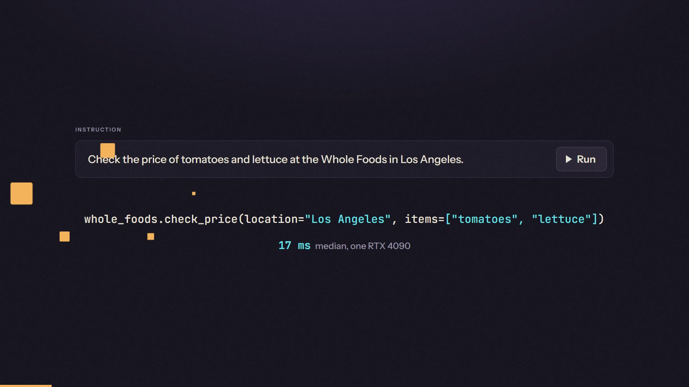
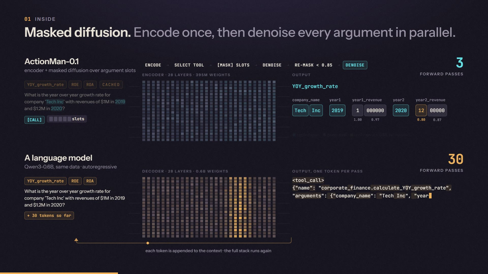
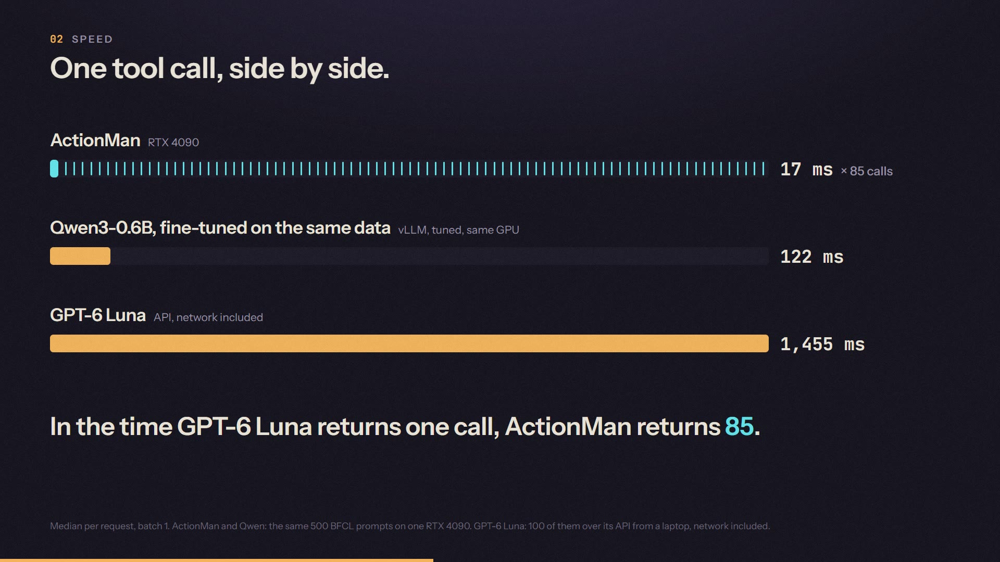

<p align="center"></p>

<h1 align="center">ActionMan</h1>

<p align="center"><b>Decision models choose. Action models act.</b></p>

Decision models read the input once, score every option in parallel, and answer in milliseconds. But a decision is not an
action. A tool call needs arguments, and arguments are text, which until now meant an LLM decoding one token at a time.

**ActionMan-0.1 is an action model.** It is a 0.4B encoder that selects the tool in one forward pass and writes every argument
with masked diffusion. It finishes in 2-3 forward passes, with no autoregressive decoding and no JSON generated.



## Links

- **The launch film (1:00):** [actionman-launch-film.mp4](https://github.com/shing1Sks/ActionMan/releases/download/v0.1/actionman-launch-film.mp4), source in [`video/`](video/)
- **Weights:** [huggingface.co/shing-dev/ActionMan-0.1](https://huggingface.co/shing-dev/ActionMan-0.1)
- **Benchmark report:** [`docs/results/benchmark.md`](docs/results/benchmark.md) (BFCL v4 official harness, GPU and CPU latency, calibration)
- **The Arena:** [`docs/arena/`](docs/arena/README.md), three real-time games played only through tool calls
- **Lab record:** [`docs/results/findings.md`](docs/results/findings.md), every run in order

## Inside



**ActionMan** (ModernBERT-large encoder, 28 layers, 395M weights):
1. **Encode.** The tool signatures, the instruction and up to four `[CALL]` markers are encoded once. The context is cached.
2. **Select tool.** Each `[CALL]` scores every tool, or none, in the same forward pass. A length head sizes the slots for every argument.
3. **[MASK] slots.** One block of masked slots is appended, covering every argument of every call.
4. **Denoise.** All slots are predicted in parallel:
   - **copy:** values that appear in the instruction are copied as spans ("Tech Inc", "2019"), so they can't be misspelled;
   - **options:** enums and booleans are picked from their options;
   - **lists:** lists get a count head and item slots.
5. **Re-mask < 0.85, denoise.** Low-confidence slots are re-masked and predicted again. Most calls are done in 2-3 forward passes.

**A language model** runs its full stack once per output token. The same call is about 80 forward passes of autoregressive decoding.

## Speed



| One tool call, median, batch 1 | latency |
|---|---|
| **ActionMan-0.1** (RTX 4090, compiled with CUDA graphs) | **17 ms** |
| Qwen3-0.6B fine-tuned on the same data (vLLM, tuned, same GPU) | 122 ms |
| Qwen3-0.6B fine-tuned on the same data (llama.cpp Q8_0, same GPU) | 159 ms |
| GPT-6 Luna (API, reasoning low, network included) | 1,455 ms |

In the time GPT-6 Luna returns one call, ActionMan returns 85.

- **Latency is flat in the size of the answer.** An LLM pays for every output token; ActionMan fills every slot at once.

  | gold calls in the answer | ActionMan | Qwen3-0.6B, vLLM |
  |---|---|---|
  | 1 | 16.8 ms | 111 ms |
  | 3+ | 21.0 ms | 331 ms |

- **Server CPU** (8 threads): 0.45 s for ActionMan fp32 vs 1.66 s for llama.cpp Q8_0.


## The Arena

Three games played only through tool calls. **The clock is the model:** every action costs one 10 ms tick, and thinking time is
charged in full, so the world keeps moving while a model thinks. Every model gets the same situation, one call per turn, on
renamed controls.


| Wins out of 12 | ActionMan-0.1 | Qwen3-0.6B, same data | GPT-6 Luna |
|---|---|---|---|
| **2D Minecraft:** dig to the diamond, zombies hunting | **10**, in 0.4-2.1 s | 9, in 4.9-19 s | 10, in 17-70 s |
| **Rally:** pace notes at 360 km/h, a late call is a crash | **11** | 9 | 3 |
| **Cycling:** every `pedal()` call is one stroke; calls per second is power | **11** | 3 | 3 |
| thinking per call | 13-26 ms | 0.34-0.46 s | 1.2-1.3 s |

Rules, levels and every replay: [`docs/arena/README.md`](docs/arena/README.md).

## Accuracy

| BFCL v4, official harness | size | Non-Live | Live | Irrelevance |
|---|---|---|---|---|
| **ActionMan-0.1** | 0.4B | 66.0 | 45.1 | **81.2** |
| Hammer2.1-0.5b | 0.49B | 65.9 | 54.7 | 80.7 |
| granite-4.0-350m | 0.35B | 67.7 | 46.7 | 61.1 |
| Qwen3-0.6B (FC) | 0.75B | 72.9 | 58.8 | 80.9 |
| Qwen3-0.6B fine-tuned on the same data | 0.75B | 75.7 | 54.1 | 79.1 |
| Qwen3-1.7B (FC) | 2.0B | 82.7 | 74.7 | 76.8 |
| GPT-6 Luna (API, reasoning low) | - | 78.2 | 68.8 | 75.6 |

- **Harness check:** every model ran on one box with `bfcl-eval==2026.3.23`. The harness reproduces the public leaderboard for Hammer and
  granite within 0.25 points.
- **Single-turn categories only.**
- **Per-category scores:** confidence intervals and error classes are in the [benchmark report](docs/results/benchmark.md).

## Try it

```bash
pip install "git+https://github.com/shing1Sks/ActionMan"        # torch, transformers>=5, safetensors, huggingface_hub
```

```python
from actionman.api import ActionMan

am = ActionMan.from_pretrained("shing-dev/ActionMan-0.1")    # compiles on GPU (one-off warm-up)
tools = [{"type": "function", "function": {
    "name": "get_weather", "description": "Current weather for a city",
    "parameters": {"type": "object", "properties": {
        "city": {"type": "string"}, "unit": {"type": "string", "enum": ["celsius", "fahrenheit"]}},
        "required": ["city"]}}}]
am.predict("What's the weather in Paris in celsius?", tools)
# [{"name": "get_weather", "arguments": {"city": "Paris", "unit": "celsius"}, "confidence": 0.98}]
am.predict("Tell me a joke", tools)
# []
```

- **Tools:** OpenAI-style function schemas.
- **Output:**
  - `[]` means no tool fits.
  - `require=True` forces a call, like `tool_choice="required"`.
  - `confidence` is the minimum over the tool and every argument.
- **Scope:** single turn, English, up to 4 calls per request, lists of up to 7 items.

## Repo map

| Path | What |
|---|---|
| `src/actionman/` | the model: `schema`, `features`, `model`, `cached` (block-causal context cache), `infer` + `infer_v3` (masked diffusion with copy, option and list slots), `train`, `evaluate`, `scoring`, `api`, `export_hf` |
| `baseline/qwen.py` | the Qwen3-0.6B baseline, fine-tuned on the same data |
| `bench/` | BFCL v4 harness integration, the latency harness (ActionMan, vLLM, llama.cpp, HF, CPU), `report.py` |
| `arena/` | the games (`mining/` is 2D Minecraft, plus `rally/` and `cycling/`), the drivers, `run.py`, and the replay viewer |
| `infra/` | Vast.ai launcher with three layers of spend safety, cost and results reports |
| `video/` | the launch film (`launch.html`) and the research cut (`index.html`): animated pages, a frame renderer, a synthesised soundtrack |
| `docs/` | design, plans, findings, the benchmark report, Arena docs |
| `tests/` | 135 CPU tests on tiny random models (`python -m pytest -q`) |

## What's next

- **CPU:** int8 / ONNX export and a ModernBERT-base variant, for laptop and on-device speed.
- **Live prompts:** training on long, multi-message prompts.
- **Multi-turn:** carrying the conversation.
- **Open weights:** a retrain without xLAM.

## Credits

**Data:**
- [xLAM function-calling 60k](https://huggingface.co/datasets/Salesforce/xlam-function-calling-60k): CC-BY-4.0, research use;
- [ToolACE](https://huggingface.co/datasets/Team-ACE/ToolACE): Apache-2.0;
- [Hermes function-calling v1](https://huggingface.co/datasets/NousResearch/hermes-function-calling-v1): Apache-2.0;
- [BFCL](https://gorilla.cs.berkeley.edu/leaderboard.html): evaluation only.

**Encoder:** [ModernBERT-large](https://huggingface.co/answerdotai/ModernBERT-large) (Apache-2.0).

Research by Shreyash Kumar Singh with an AI coding agent (Claude).

**Licence:** the code is MIT. The weights are for research use only, because the training data includes xLAM-60k.
