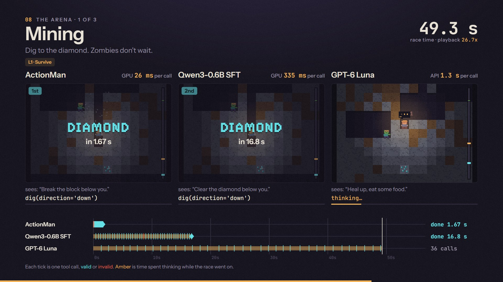
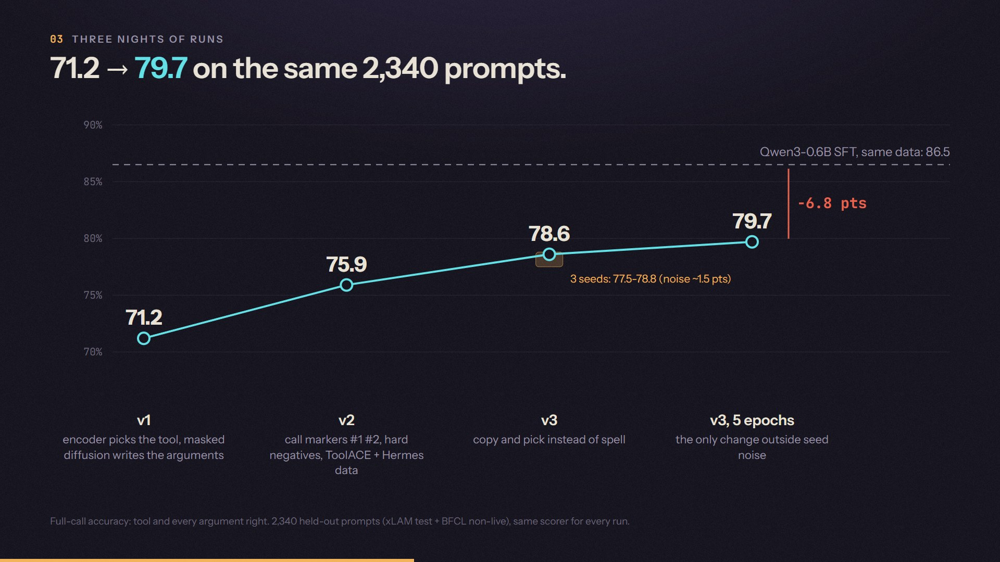

# ActionMan

**Can a decision model also act?**

Decision models read the input once, score every option in parallel, and answer in milliseconds. They can choose, but they can't
*act*: a tool call needs arguments, and arguments are text. LLMs can write those arguments, but only one token at a time.
ActionMan started as a question in between: keep the one-read decision encoder, and snap a masked-diffusion argument writer on top
that fills every argument at once, in two or three passes.

This repo is the full, open record of trying it: the architecture, three nights of runs, what failed, the benchmarks and an arena.
The result is **ActionMan-0.1**, a 0.4B tool caller (ModernBERT-large plus small heads) trained for about $16 of rented GPU time.

> **Early research preview.** On one RTX 4090 it answers in **17 ms** where the same-data Qwen3-0.6B served by tuned vLLM takes
> **121 ms** (7x; 16x for answers with three or more calls). It is also **less accurate** than that LLM (BFCL v4 Non-Live 66.0 vs
> 75.7), single-turn only, and slow on a laptop CPU. Fast and interesting; not a drop-in replacement for an LLM tool caller.


*The arena. Same instruction, same renamed controls, real thinking time charged to every model. ActionMan finds the diamond in 1.7 s.*

## Links

- **Benchmark report:** [`docs/results/benchmark.md`](docs/results/benchmark.md) (BFCL v4 official harness, latency, CPU, calibration)
- **Weights:** [huggingface.co/shing-dev/ActionMan-0.1](https://huggingface.co/shing-dev/ActionMan-0.1)
- **The film (~2 min):** [the research as a short video](https://github.com/shing1Sks/ActionMan/releases/download/v0.1/actionman-research-film.mp4), source in [`video/`](video/)
- **Arena:** [`docs/arena/`](docs/arena/README.md) (mining, rally, cycling) and the replay viewer in [`arena/viewer/`](arena/viewer/)
- **Lab record:** [`docs/results/findings.md`](docs/results/findings.md) (every run and result, newest first), plans in [`docs/plans/`](docs/plans/)

## The idea in one picture


- **One read picks the tools.** The tools and the query go into the encoder with up to four `[CALL]` markers. Each marker picks a
  tool or none, Jev-style, against the tool-name tokens. A length head sizes every argument's slots.
- **Every argument is written at once.** A slot block is appended after the input and filled in parallel by masked diffusion
  (mask-predict). Slots below 0.85 confidence are re-masked and refilled; most requests finish in 2-3 passes.
- **Copy and pick instead of spell.** Most argument values are already in the query ("Tech Inc", "2019"), so a copy switch points
  at the span instead of writing it. Booleans and enums are picked from their options. Lists get a count head and item slots.
- **The input is encoded once.** The input's states are cached, and only the slot block is re-run on each pass. The passes run as
  CUDA graphs.

No JSON is ever generated. The structure comes from the schema; the model only fills the values.

## Results

| BFCL v4, official harness | size | Non-Live | Live | Irrelevance |
|---|---|---|---|---|
| **ActionMan-0.1** | 0.4B | 66.0 | 45.1 | **81.2** |
| Hammer2.1-0.5b | 0.49B | 65.9 | 54.7 | 80.7 |
| granite-4.0-350m | 0.35B | 67.7 | 46.7 | 61.1 |
| Qwen3-0.6B (FC) | 0.75B | 72.9 | 58.8 | 80.9 |
| Qwen3-0.6B SFT on ActionMan's data | 0.75B | 75.7 | 54.1 | 79.1 |
| Qwen3-1.7B (FC) | 2.0B | 82.7 | 74.7 | 76.8 |
| GPT-6 Luna (API, reasoning low) | - | 78.2 | 68.8 | 75.6 |

| Latency, batch 1, one RTX 4090, 500 BFCL prompts | p50 | p95 | correct on those 500 |
|---|---|---|---|
| **ActionMan-0.1, compiled** | **17.0 ms** | 28.9 ms | 59.2% |
| Qwen3-0.6B SFT, vLLM (tuned) | 121 ms | 347 ms | 68.6% |
| Qwen3-0.6B SFT, llama.cpp Q8_0 on GPU | 159 ms | 336 ms | 69.0% |
| Server CPU, 8 threads: ActionMan fp32 vs llama.cpp Q8_0 | 0.45 s vs 1.66 s | | 59.0% vs 66.5% |


**How to read these results:**
- **Answer length:** an LLM pays for every output token, while ActionMan stays flat.
  - One call: 16.8 vs 111 ms.
  - Three or more calls: 21 vs 331 ms.
- **Own eval:** on our 2,340 held-out prompts (official checker) it scores 79.0 against 85.6 for the same-data Qwen. Tool choice
  and "don't call" are level with Qwen, and the gap is in the arguments.
- **Harness check:** the harness reproduces the public leaderboard for Hammer and granite within 0.25 points.
- **What is not reported:**
  - **No BFCL Overall:** multi-turn and agentic categories were not run.
  - **No functiongemma-270m:** it was not evaluated, because it is gated.

## The arena

Three tiny real-time games played only through tool calls, where **the clock is the model**: every action costs one 10 ms tick and
everything else is the model's real thinking time. The world keeps moving while a model thinks.

| 12 races per event | ActionMan-0.1 | Qwen3-0.6B SFT | GPT-6 Luna | Perfect driver |
|---|---|---|---|---|
| Mining: dig to a diamond, zombies hunting | **10**, in 0.4-2.1 s | 9, in 4.9-19 s | **10**, in 17-70 s | 12 |
| Rally: pace notes at 360 km/h | **11** | 9 | 3 | 12 |
| Cycling: every call is one pedal stroke | **11** | 3 | 3 | 12 |
| thinking per call | 13-26 ms | 0.34-0.46 s | 1.2-1.3 s | - |

**How it works:**
- **Each turn the model gets one plain instruction** ("Dig down.", "Left 4 is the next corner.") from a scripted planner. ActionMan
  does not plan: from a description of the state instead, it wins 1 of 12 mining races.
- **It tests the job ActionMan is for:** turning a request into the right call on unfamiliar, renamed controls, fast.
- **GPT-6 Luna never sends an invalid call,** but in rally and cycling it arrives a second late.

Details and caveats: [`docs/arena/README.md`](docs/arena/README.md).

## What we learned

1. **Copying beats spelling.** 80-92% of BFCL string values appear word for word in the query.
   - Pointing at the span instead of writing it cut garbled values from 77 to 13 and added 2.7 points (v2 -> v3).
   - What remains is mostly reasoning: "until 11 PM" -> `23`, unit conversion. An encoder this size can't do that.
2. **Parallel decoding makes latency flat in the answer's length.** That is where the speed gap opens up: 7x for one call, 16x for
   three or more. A naive baseline exaggerates it. Against HF `generate` we first measured 90x; against tuned vLLM it is 7x.
3. **Seed noise is about 1.5 points on 2,340 prompts.** Most of our "improvements" were inside it: distillation from Qwen3-14B,
   +80% more data, word-boundary snapping, a masking fix. Only 5 epochs stood outside it (79.7).
4. **Check the baseline's config, not just its numbers.** Our Qwen SFT config was written by transformers 5. Older vLLM read it with
   the wrong RoPE base and quietly scored it about 12 points low. It was caught because llama.cpp disagreed.
5. **Instructions, not states.** ActionMan translates; it does not plan. Given orders it wins most races; given a
   description of the world it loops.



## Try it

```bash
pip install "git+https://github.com/shing1Sks/ActionMan"        # torch, transformers>=5, safetensors, huggingface_hub
```

```python
from actionman.api import ActionMan

am = ActionMan.from_pretrained("shing-dev/ActionMan-0.1")    # compiles on GPU (one-off warm-up)
tools = [{"type": "function", "function": {
    "name": "get_weather", "description": "Current weather for a city",
    "parameters": {"type": "object", "properties": {
        "city": {"type": "string"}, "unit": {"type": "string", "enum": ["celsius", "fahrenheit"]}},
        "required": ["city"]}}}]
am.predict("What's the weather in Paris in celsius?", tools)
# [{"name": "get_weather", "arguments": {"city": "Paris", "unit": "celsius"}, "confidence": 0.98}]
```

- **Tools:** OpenAI-style function schemas.
- **No call:** an empty list means no tool fits. `require=True` forces a call, like `tool_choice="required"`.
- **`confidence`** is the minimum over the tool and every argument. Abstaining on the least confident 10% of answers takes our eval
  from 78.6 to 85.1.
- **Limits:** single turn, English, at most 4 calls and lists of up to 7 items.

## Repo map

| Path | What |
|---|---|
| `src/actionman/` | the model: `schema` (tools, calls, converters), `features`, `model`, `cached` (block-causal cache), `infer` + `infer_v3` (mask-predict, copy, options, lists), `train`, `evaluate`, `scoring`, `api`, `export_hf` |
| `src/actionman/` (analysis) | `audit` (argument data audit), `errclass` (error classes), `distill` (teacher relabel), `prepare` + `extra` (data), `profile` |
| `baseline/qwen.py` | the Qwen3-0.6B SFT baseline: same data, same scorer |
| `bench/` | BFCL v4 harness glue (`bfcl_run.py`, `bfcl_actionman.py`), latency harness (`latency.py`), box jobs, `report.py` |
| `arena/` | the games (`mining/`, `rally/`, `cycling/`), the drivers, `run.py`, and the replay viewer (`viewer/`) |
| `infra/` | Vast.ai launcher with three layers of spend safety (self-destroying job, watchdog, laptop watcher), costs, results |
| `video/` | the research film: one animated page, a frame-by-frame renderer and a synthesised soundtrack |
| `docs/` | design spec, plans, findings, the benchmark report, arena docs |
| `tests/` | 135 CPU tests on tiny random models (`python -m pytest -q`) |

## What's next

- **CPU speed:** int8 and ONNX export, and a ModernBERT-base variant. Laptop CPU is the weak spot today.
- **Live prompts:** long multi-message prompts are where it falls furthest behind (Live 45). Train on them.
- **Multi-turn:** carry the conversation.
- **A clean-licence retrain without xLAM,** so the weights can be released under open terms.

## Credits

Data:
- [xLAM function-calling 60k](https://huggingface.co/datasets/Salesforce/xlam-function-calling-60k): CC-BY-4.0, research use;
- [ToolACE](https://huggingface.co/datasets/Team-ACE/ToolACE): Apache-2.0;
- [Hermes function-calling v1](https://huggingface.co/datasets/NousResearch/hermes-function-calling-v1): Apache-2.0;
- [BFCL](https://gorilla.cs.berkeley.edu/leaderboard.html): evaluation only.

Encoder: [ModernBERT-large](https://huggingface.co/answerdotai/ModernBERT-large) (Apache-2.0).
Inspired by decision models such as Jev.
Research run by Shreyash Kumar Singh with an AI coding agent (Claude).

Code: MIT. Weights: research preview, for research use only (trained on xLAM-60k).
