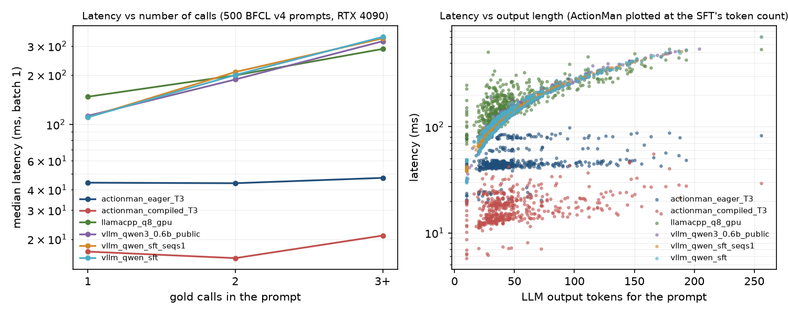
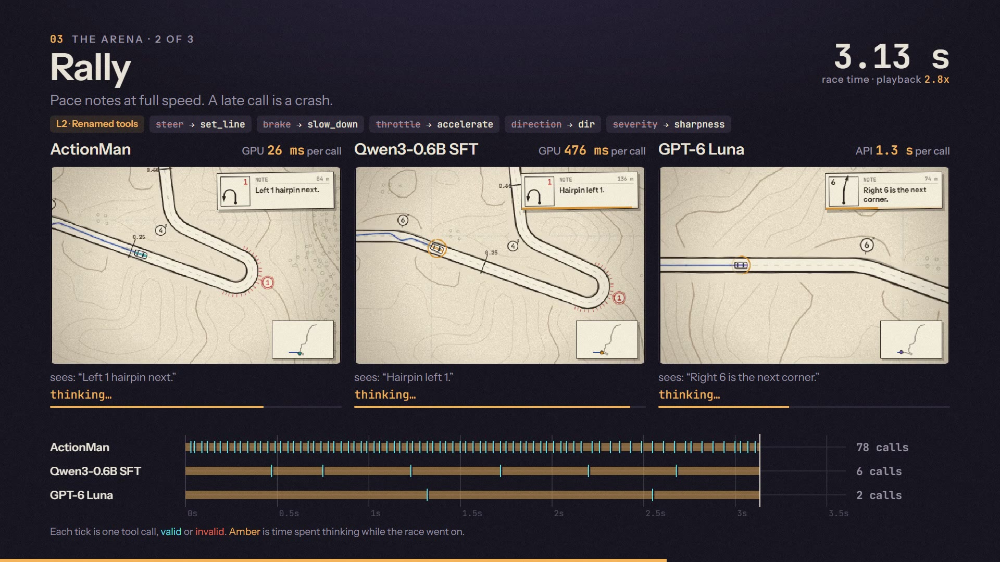

# ActionMan-0.1

**Decision models choose. Action models act.**

ActionMan-0.1 is an action model: a 0.4B encoder that selects the tool in one forward pass and writes every argument with
masked diffusion. It finishes in 2-3 forward passes, with no autoregressive decoding and no JSON generated.

| One tool call, median, batch 1 | latency |
|---|---|
| **ActionMan-0.1** (RTX 4090) | **17 ms** |
| Qwen3-0.6B fine-tuned on the same data (vLLM, tuned, same GPU) | 122 ms |
| GPT-6 Luna (API, network included) | 1,455 ms |

In the time GPT-6 Luna returns one call, ActionMan returns 85.

## Inside


1. **Encode.** ModernBERT-large (28 layers, 395M weights) encodes the tool signatures, the instruction and up to four `[CALL]`
   markers once. The context is cached.
2. **Select tool.** Each `[CALL]` scores every tool, or none. A length head sizes the slots for every argument.
3. **[MASK] slots.** One block of masked slots is appended, covering every argument.
4. **Denoise.** All slots are predicted in parallel:
   - values that appear in the instruction are copied as spans;
   - enums and booleans are picked from their options;
   - lists get a count head and item slots.
5. **Re-mask < 0.85, denoise.** Low-confidence slots are re-masked and predicted again. The passes run as CUDA graphs.

A language model runs its full stack once per output token. The same call takes about 80 forward passes.

## Speed



Latency is flat in the size of the answer:

| | 1 call | 3+ calls |
|---|---|---|
| ActionMan-0.1 | 16.8 ms | 21.0 ms |
| Qwen3-0.6B, vLLM | 111 ms | 331 ms |

On a server CPU (8 threads), ActionMan fp32 takes 0.45 s and llama.cpp Q8_0 takes 1.66 s.

## The Arena



Three real-time games played only through tool calls, where thinking time is charged to the model.

| Wins out of 12 | ActionMan-0.1 | Qwen3-0.6B, same data | GPT-6 Luna |
|---|---|---|---|
| 2D Minecraft | **10** | 9 | 10 |
| Rally | **11** | 9 | 3 |
| Cycling | **11** | 3 | 3 |

## Accuracy

| BFCL v4, official harness | size | Non-Live | Live | Irrelevance |
|---|---|---|---|---|
| **ActionMan-0.1** | 0.4B | 66.0 | 45.1 | **81.2** |
| Hammer2.1-0.5b | 0.49B | 65.9 | 54.7 | 80.7 |
| granite-4.0-350m | 0.35B | 67.7 | 46.7 | 61.1 |
| Qwen3-0.6B (FC) | 0.75B | 72.9 | 58.8 | 80.9 |
| Qwen3-0.6B fine-tuned on the same data | 0.75B | 75.7 | 54.1 | 79.1 |
| Qwen3-1.7B (FC) | 2.0B | 82.7 | 74.7 | 76.8 |
| GPT-6 Luna (API, reasoning low) | - | 78.2 | 68.8 | 75.6 |

- **The run:** every model ran with `bfcl-eval==2026.3.23` on one box, single-turn categories only.
- **Full report:** per-category scores, confidence intervals and error classes are in [benchmark.md](https://github.com/shing1Sks/ActionMan/blob/dev/docs/results/benchmark.md).

## Usage

```bash
pip install "git+https://github.com/shing1Sks/ActionMan"        # torch, transformers>=5, safetensors, huggingface_hub
```

```python
from actionman.api import ActionMan

am = ActionMan.from_pretrained("shing-dev/ActionMan-0.1")    # compiles on GPU (one-off warm-up)
tools = [{"type": "function", "function": {
    "name": "get_weather", "description": "Current weather for a city",
    "parameters": {"type": "object", "properties": {
        "city": {"type": "string"}, "unit": {"type": "string", "enum": ["celsius", "fahrenheit"]}},
        "required": ["city"]}}}]
am.predict("What's the weather in Paris in celsius?", tools)
# [{"name": "get_weather", "arguments": {"city": "Paris", "unit": "celsius"}, "confidence": 0.9812}]
am.predict("Tell me a joke", tools)
# []
```

- **Without pip:** the inference code is also in this repo under `code/actionman/`. Add `code/` to `sys.path`.
- **No call:** `[]` means no tool fits. `require=True` forces a call, like `tool_choice="required"`.
- **`confidence`** is the minimum over the tool and every argument. Abstaining below a threshold works well: skipping the 10% least
  confident calls takes accuracy on our 2,340-prompt eval from 78.6 to 85.1.
- **Specs:**
  - single turn, English;
  - up to 4 calls per request;
  - lists of up to 7 items;
  - an input of about 896 tokens.

## Training

- **Data:** 5 epochs over 80,459 rows:
  - xLAM-60k, 58,000;
  - ToolACE, 10,359;
  - Hermes v1, 1,100;
  - no-call examples, 11,000.
- **Hardware:** one RTX 4090, about 2 hours.

## Licence

- **The weights are for research use only.** The training data includes Salesforce's xLAM-60k, whose card says "This release is for research purposes only."
- **ToolACE and Hermes** are Apache-2.0.
- **The inference code** is MIT.

## Links

- **Code, benchmarks, the Arena:** [github.com/shing1Sks/ActionMan](https://github.com/shing1Sks/ActionMan)
- **The launch film:** [actionman-launch-film.mp4](https://github.com/shing1Sks/ActionMan/releases/download/v0.1/actionman-launch-film.mp4)

Research by Shreyash Kumar Singh with an AI coding agent (Claude).
