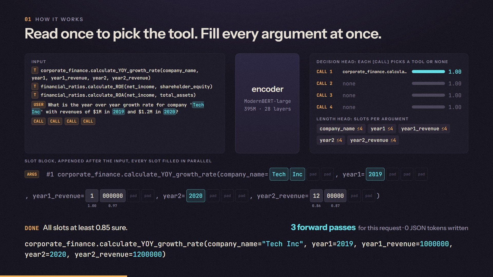
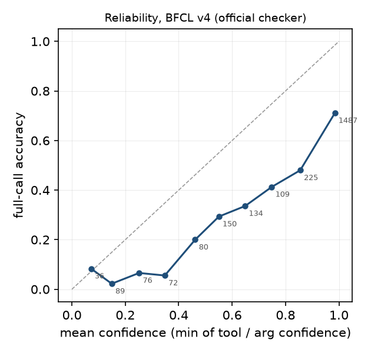

# ActionMan-0.1

**A 0.4B tool caller that doesn't write JSON.**
- One encoder read picks the tool.
- Masked diffusion fills every argument at once, in two or three passes.

ActionMan started as a question: decision models answer in milliseconds but can only choose, while LLMs can act but write one token
at a time. Can a decision-style encoder also write the arguments?

> **Early research preview.**
> - **Speed:** on one RTX 4090 at batch 1 it answers in **17 ms** (p50), where the same-data Qwen3-0.6B served by tuned vLLM takes
>   **121 ms**. That is 7x for one call and 16x for three or more.
> - **Accuracy:** it is **less accurate** than that LLM (BFCL v4 Non-Live 66.0 vs 75.7).
> - **Scope:** it is single-turn only, and it is slow on a laptop CPU.
>
> It is fast and well calibrated; it is not a drop-in replacement for an LLM tool caller.



## How it works

- **Encoder:** ModernBERT-large (395M) reads the tools (as compact signatures), the query, and up to four `[CALL]` markers.
- **Decision head:** each marker picks a tool or none, by dot product against the tool-name tokens. A length head sizes each argument.
- **Slot block:** it is appended after the input and filled in parallel by mask-predict. Slots below 0.85 confidence are re-masked;
  most requests finish in 2-3 passes. The input is encoded once and cached; the passes run as CUDA graphs.
- **Copy, pick, list:**
  - A copy switch points at a span of the query instead of spelling the value.
  - Booleans and enums (up to 16 options) are picked from their options.
  - Lists get a count head and item slots.

About 410M unique parameters. The decoder is tied to the embeddings, but it is stored twice in the bf16 file.

## Results

| BFCL v4, official harness (`bfcl-eval==2026.3.23`) | size | Non-Live | Live | Irrelevance |
|---|---|---|---|---|
| **ActionMan-0.1** | 0.4B | 66.0 | 45.1 | **81.2** |
| Hammer2.1-0.5b | 0.49B | 65.9 | 54.7 | 80.7 |
| granite-4.0-350m | 0.35B | 67.7 | 46.7 | 61.1 |
| Qwen3-0.6B (FC) | 0.75B | 72.9 | 58.8 | 80.9 |
| Qwen3-0.6B fine-tuned on ActionMan's data | 0.75B | 75.7 | 54.1 | 79.1 |
| Qwen3-1.7B (FC) | 2.0B | 82.7 | 74.7 | 76.8 |

| Latency, batch 1, RTX 4090, 500 BFCL v4 prompts, end to end | p50 | p95 | correct on the 500 |
|---|---|---|---|
| **ActionMan-0.1, compiled** | **17.0 ms** | 28.9 ms | 59.2% |
| Qwen3-0.6B fine-tuned, vLLM 0.11 (tuned) | 121 ms | 347 ms | 68.6% |
| Qwen3-0.6B fine-tuned, llama.cpp Q8_0, GPU | 159 ms | 336 ms | 69.0% |
| 8 server CPU threads: ActionMan fp32 vs llama.cpp Q8_0 | 0.45 s | | 59.0% vs 66.5% |


- **The harness** reproduces the public leaderboard for Hammer and granite within 0.25 Non-Live points.
- **No BFCL Overall:** multi-turn and agentic categories were not run.
- **The full report** has per-category scores with confidence intervals, error classes, and our own 2,340-prompt eval:
  [docs/results/benchmark.md](https://github.com/shing1Sks/ActionMan/blob/dev/docs/results/benchmark.md).

## Usage

```bash
pip install "git+https://github.com/shing1Sks/ActionMan"        # torch, transformers>=5, safetensors, huggingface_hub
```

```python
from actionman.api import ActionMan

am = ActionMan.from_pretrained("shing-dev/ActionMan-0.1")    # compiles on GPU (one-off warm-up)
tools = [{"type": "function", "function": {
    "name": "get_weather", "description": "Current weather for a city",
    "parameters": {"type": "object", "properties": {
        "city": {"type": "string"}, "unit": {"type": "string", "enum": ["celsius", "fahrenheit"]}},
        "required": ["city"]}}}]
am.predict("What's the weather in Paris in celsius?", tools)
# [{"name": "get_weather", "arguments": {"city": "Paris", "unit": "celsius"}, "confidence": 0.9812}]
am.predict("Tell me a joke", tools)
# []
```

- **Without pip:** the inference code is also in this repo under `code/actionman/`. Add `code/` to `sys.path`.
- **No call:** an empty list means no tool fits. `require=True` forces a call, like `tool_choice="required"`.
- **`confidence`** is the minimum over the tool and every argument.

## Calibration: knowing when it doesn't know



| | our eval (2,340 prompts) | BFCL v4 Python |
|---|---|---|
| accuracy, answering everything | 78.6 | 56.1 |
| accuracy when the least confident 10% abstain | 85.1 | 62.1 |
| accuracy when the least confident 20% abstain | 89.5 | 66.9 |

Confidence ranks errors well, but it is over-confident on BFCL (ECE 0.28, vs 0.11 on our eval). Use it as a threshold, not as a probability.

## Limits

- **Single turn, English.** At most 4 calls per request, lists of up to 7 items, and an input of about 896 tokens.
- **No reasoning.**
  - Values that are not in the text are its main error: "until 11 PM" -> `23`, unit conversion, world knowledge.
  - On long, real user prompts (BFCL Live) it falls well behind small LLMs.
- **CPU:** 0.45 s per call on 8 server cores, and several seconds on a laptop CPU. The speed claim is a GPU claim.
- **The arena:** ActionMan executes instructions; it does not plan. Given a description of a game state instead of an instruction,
  it loops (1 of 12 mining races won).

## Training

- **Data:** 5 epochs over 80,459 rows:
  - xLAM-60k, 58,000;
  - ToolACE, 10,359;
  - Hermes v1, 1,100;
  - no-call negatives, 11,000 (built from xLAM queries).
- **Hardware and cost:** one RTX 4090, about 2 hours. The whole research, every run included, cost about $16 of rented GPU time,
  plus $2 for the benchmarks.

## Licence

- **The weights are a research preview, for research use only.** The training data includes Salesforce's xLAM-60k, whose card
  says "This release is for research purposes only."
- **ToolACE and Hermes are Apache-2.0.**
- **The inference code is MIT.**
- **Open weights** would need a retrain without xLAM, which is planned.

## Links

- **Code, benchmarks, arena:** [github.com/shing1Sks/ActionMan](https://github.com/shing1Sks/ActionMan)
- **The research film:** [actionman-research-film.mp4](https://github.com/shing1Sks/ActionMan/releases/download/v0.1/actionman-research-film.mp4)

Research by Shreyash Kumar Singh with an AI coding agent (Claude).
